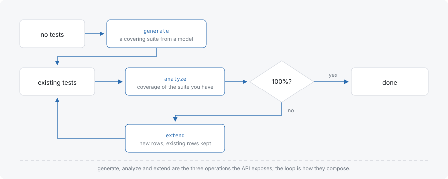

# coverwise

[](https://github.com/libraz/coverwise/actions)
[](https://www.npmjs.com/package/@libraz/coverwise)
[](https://pypi.org/project/coverwise/)
[](https://codecov.io/gh/libraz/coverwise)
[](https://github.com/libraz/coverwise/blob/main/LICENSE)
[](https://en.cppreference.com/w/cpp/17)
[](https://www.typescriptlang.org/)
[](https://github.com/libraz/coverwise)

**coverwise measures what a test suite covers and writes the tests it is missing.** It reports the t-wise coverage of a suite you already have, appends only the rows that close its gaps, or builds a covering suite from scratch. One C++ engine runs behind TypeScript (WebAssembly or a pure TypeScript port), Python, C++ and a command-line tool, and coverage analysis enumerates tuples on its own rather than through the generator, so it judges a hand-written suite as readily as a generated one.

📖 **[Documentation](https://github.com/libraz/coverwise/blob/main/docs/en/introduction.md)** &nbsp;·&nbsp; **[Getting started](https://github.com/libraz/coverwise/blob/main/docs/en/getting-started.md)** &nbsp;·&nbsp; **[Primer](https://github.com/libraz/coverwise/blob/main/docs/en/primer/index.md)**



## What's inside

- **Coverage analysis** — measures any suite's t-wise coverage and names every uncovered combination. [Audit an existing suite](https://github.com/libraz/coverwise/blob/main/docs/en/use-cases/audit-an-existing-suite.md)
- **Incremental extension** — appends only the rows that close the gaps, leaving the existing rows unchanged and in order. [Close the gaps incrementally](https://github.com/libraz/coverwise/blob/main/docs/en/use-cases/close-the-gaps-incrementally.md)
- **Pairwise and t-wise generation** — covering suites at strength 2 and above, greedy, between 1.3 and 3.7 times the theoretical minimum across the published configurations. [Performance](https://github.com/libraz/coverwise/blob/main/docs/en/performance.md)
- **Constraints** — `IF/THEN/ELSE`, `IMPLIES`, `AND/OR/NOT`, comparisons, `IN` and `LIKE`; a row that violates one is never generated. [Constraint syntax](https://github.com/libraz/coverwise/blob/main/docs/en/constraints.md)
- **Negative testing** — values marked `invalid` become single-fault negative tests. [Negative testing](https://github.com/libraz/coverwise/blob/main/docs/en/examples.md#negative-testing)
- **Mixed strength** — sub-models raise the strength over a critical group of parameters. [Mixed strength](https://github.com/libraz/coverwise/blob/main/docs/en/examples.md#mixed-strength-for-a-critical-group)
- **Boundaries and classes** — numeric ranges expand into edge and near-edge values, and equivalence classes track coverage per class. [Boundary values](https://github.com/libraz/coverwise/blob/main/docs/en/examples.md#boundary-value-expansion) · [Equivalence classes](https://github.com/libraz/coverwise/blob/main/docs/en/examples.md#equivalence-classes)
- **Seed tests** — generation starts from rows that must be in the suite. [Seed tests](https://github.com/libraz/coverwise/blob/main/docs/en/examples.md#seed-tests)
- **Deterministic** — the same valid input and seed produce the same suite on every surface. [Determinism](https://github.com/libraz/coverwise/blob/main/docs/en/determinism.md)
- **pytest helper** — `coverwise.parametrize` replaces a cross-product with a covering suite. [Replace a cross-product in pytest](https://github.com/libraz/coverwise/blob/main/docs/en/use-cases/replace-a-cross-product-in-pytest.md)

## Installation

```bash
npm install @libraz/coverwise   # JavaScript / TypeScript: WebAssembly, plus a pure TypeScript entry point
pip install coverwise            # Python, with the native coverwise CLI
```

The npm package needs Node.js 18 or later and is ESM only; it installs no executable. Python wheels need Python 3.10 or later and are built for Linux x86_64 and aarch64 (glibc 2.28 or newer) and for macOS 14 or later on Apple Silicon. The C++ library builds from source with CMake. See [Getting started](https://github.com/libraz/coverwise/blob/main/docs/en/getting-started.md#installation) for every surface and for the Linux x64 CLI archives on GitHub Releases.

## Quick start

### JavaScript / TypeScript (WASM)

```typescript
import { Coverwise } from '@libraz/coverwise';

const cw = await Coverwise.create();

const parameters = [
  { name: 'os',      values: ['Windows', 'macOS', 'Linux'] },
  { name: 'browser', values: ['Chrome', 'Firefox', 'Safari'] },
  { name: 'env',     values: ['staging', 'production'] },
];

// A hand-written suite, as a project would already have it:
const myExistingTests = [
  { os: 'Windows', browser: 'Chrome',  env: 'production' },
  { os: 'macOS',   browser: 'Safari',  env: 'production' },
  { os: 'Linux',   browser: 'Firefox', env: 'staging' },
  { os: 'Windows', browser: 'Firefox', env: 'staging' },
];

const report = cw.analyzeCoverage(parameters, myExistingTests);
report.coverageRatio;         // 0.5238095238095238 (11 of the 21 pairs)
report.uncovered[0].display;  // 'os=Windows, browser=Safari'

const extended = cw.extendTests(myExistingTests, { parameters });
extended.tests.length;  // 11 — the four rows above, then seven that close the gaps
extended.coverage;      // 1
```

`@libraz/coverwise/pure` exposes the same API without loading WebAssembly. → [JavaScript API](https://github.com/libraz/coverwise/blob/main/docs/en/js-api.md) · [Choosing a surface](https://github.com/libraz/coverwise/blob/main/docs/en/choosing-a-surface.md)

### Python

```python
import coverwise

result = coverwise.generate(
    parameters={
        "os": ["Windows", "macOS", "Linux"],
        "browser": ["Chrome", "Firefox", "Safari"],
    },
    constraints=["IF os = Windows THEN browser != Safari"],
)

len(result["tests"])  # 8
result["coverage"]    # 1
```

→ [Python API](https://github.com/libraz/coverwise/blob/main/docs/en/python-api.md)

### C++

```cpp
#include <coverwise.h>

#include <iostream>

int main() {
  using namespace coverwise;

  model::GenerateOptions opts;
  opts.parameters = {
      {"os", {"Windows", "macOS", "Linux"}},
      {"browser", {"Chrome", "Firefox", "Safari"}},
      {"theme", {"light", "dark"}},
  };
  opts.strength = 2;

  auto result = core::Generate(opts);
  std::cout << result.tests.size() << " tests, coverage " << result.coverage << "\n";
  // 10 tests, coverage 1
}
```

→ [C++ API](https://github.com/libraz/coverwise/blob/main/docs/en/cpp-api.md)

### Command line

```bash
coverwise generate input.json > tests.json                 # build a covering suite
coverwise analyze --params params.json --tests tests.json  # measure an existing suite
coverwise extend --existing tests.json input.json          # add the tests that close the gaps
coverwise generate input.json | coverwise analyze --params input.json --tests -
```

Exit codes are `0` for success, `1` for a constraint error, `2` for insufficient coverage and `3` for invalid input. → [CLI reference](https://github.com/libraz/coverwise/blob/main/docs/en/cli.md)

## For AI coding agents

[coverwise-mcp](https://github.com/libraz/coverwise-mcp) puts this engine in the hands of a coding agent, so tests written for a function with several parameters come from a parameter model instead of combinations picked by eye. It is a Claude Code plugin that exposes the four operations as MCP tools and adds the `/cover-check`, `/cover-gen` and `/cover-extend` commands. The same server runs standalone under any MCP client, including Codex CLI, Cursor and Claude Desktop.

```text
/plugin marketplace add libraz/coverwise-mcp
/plugin install coverwise-mcp
```

## Build from source

```bash
make build            # Debug build of the library, CLI and tests
make test             # Python wheel, then the full C++ suite
make wasm             # Emscripten build of the WASM module
yarn build && yarn test   # TypeScript wrapper, then Vitest
make preflight        # every gate CI runs, cheapest first
```

`make test` builds the Python wheel first, so it needs `rye` on the path; `ctest --test-dir build` runs the C++ suite alone. Install and CMake options are covered in [Getting started](https://github.com/libraz/coverwise/blob/main/docs/en/getting-started.md#installation).

## Documentation

The documentation lives in [`docs/`](https://github.com/libraz/coverwise/tree/main/docs), in English and Japanese.

- **Learn** — [Primer](https://github.com/libraz/coverwise/blob/main/docs/en/primer/index.md) · [Introduction](https://github.com/libraz/coverwise/blob/main/docs/en/introduction.md) · [Getting started](https://github.com/libraz/coverwise/blob/main/docs/en/getting-started.md) · [Use cases](https://github.com/libraz/coverwise/blob/main/docs/en/use-cases/index.md)
- **Guides** — [Examples](https://github.com/libraz/coverwise/blob/main/docs/en/examples.md) · [Constraint syntax](https://github.com/libraz/coverwise/blob/main/docs/en/constraints.md) · [Choosing a surface](https://github.com/libraz/coverwise/blob/main/docs/en/choosing-a-surface.md) · [Determinism](https://github.com/libraz/coverwise/blob/main/docs/en/determinism.md) · [Performance](https://github.com/libraz/coverwise/blob/main/docs/en/performance.md) · [Input limits](https://github.com/libraz/coverwise/blob/main/docs/en/limits.md)
- **Reference** — [JavaScript API](https://github.com/libraz/coverwise/blob/main/docs/en/js-api.md) · [Python API](https://github.com/libraz/coverwise/blob/main/docs/en/python-api.md) · [C++ API](https://github.com/libraz/coverwise/blob/main/docs/en/cpp-api.md) · [CLI reference](https://github.com/libraz/coverwise/blob/main/docs/en/cli.md) · [Glossary](https://github.com/libraz/coverwise/blob/main/docs/en/glossary.md) · [Questions and limitations](https://github.com/libraz/coverwise/blob/main/docs/en/faq.md)

## Non-goals

coverwise produces rows of parameter values and stops there. It does not run tests or assume a test framework, it treats every value as an opaque label with no domain meaning, it cannot tell you whether pairwise is strong enough for your system, and it does not promise the smallest possible suite. [What coverwise does not do](https://github.com/libraz/coverwise/blob/main/docs/en/introduction.md#what-coverwise-does-not-do) sets out each of these.

## License

[Apache-2.0](LICENSE)
