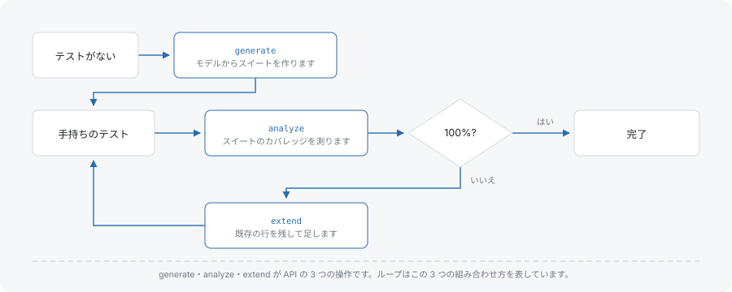

# coverwise

[](https://github.com/libraz/coverwise/actions)
[](https://www.npmjs.com/package/@libraz/coverwise)
[](https://pypi.org/project/coverwise/)
[](https://codecov.io/gh/libraz/coverwise)
[](https://github.com/libraz/coverwise/blob/main/LICENSE)
[](https://en.cppreference.com/w/cpp/17)
[](https://www.typescriptlang.org/)
[](https://github.com/libraz/coverwise)

**coverwise は、テストスイートが何を網羅しているかを計測し、足りないテストを書き足します。** 手元のスイートの t-wise カバレッジを報告し、不足を埋める行だけを追記し、あるいはカバリング配列をゼロから構築します。1 つの C++ エンジンを TypeScript（WebAssembly またはピュア TypeScript 移植版）、Python、C++、コマンドラインから使えます。カバレッジ計測はジェネレータを経由せず独自にタプルを列挙するため、手書きのスイートも生成したスイートと同じように判定できます。

📖 **[ドキュメント](https://github.com/libraz/coverwise/blob/main/docs/ja/introduction.md)** &nbsp;·&nbsp; **[はじめかた](https://github.com/libraz/coverwise/blob/main/docs/ja/getting-started.md)** &nbsp;·&nbsp; **[入門](https://github.com/libraz/coverwise/blob/main/docs/ja/primer/index.md)**



## できること

- **カバレッジ計測** — 任意のスイートの t-wise カバレッジを測り、網羅されていない組み合わせをすべて挙げます。[既存スイートを監査する](https://github.com/libraz/coverwise/blob/main/docs/ja/use-cases/audit-an-existing-suite.md)
- **差分の追加** — 不足を埋める行だけを追記し、既存の行は内容も順序も変えません。[不足を少しずつ埋める](https://github.com/libraz/coverwise/blob/main/docs/ja/use-cases/close-the-gaps-incrementally.md)
- **ペアワイズと t-wise の生成** — 強度 2 以上のカバリング配列を貪欲法で作り、行数は公開している構成で理論下限の 1.3〜3.7 倍です。[パフォーマンス](https://github.com/libraz/coverwise/blob/main/docs/ja/performance.md)
- **制約** — `IF/THEN/ELSE`、`IMPLIES`、`AND/OR/NOT`、比較演算、`IN`、`LIKE` を書けます。制約に反する行は生成されません。[制約構文](https://github.com/libraz/coverwise/blob/main/docs/ja/constraints.md)
- **異常系テスト** — `invalid` を付けた値から、無効値を 1 つだけ含む異常系テストを作ります。[異常系テスト](https://github.com/libraz/coverwise/blob/main/docs/ja/examples.md#異常系テスト)
- **混合強度** — サブモデルで、重要なパラメータのグループだけ強度を上げます。[重要なグループだけ強度を上げる](https://github.com/libraz/coverwise/blob/main/docs/ja/examples.md#重要なグループだけ強度を上げる)
- **境界値と等価クラス** — 数値の範囲を境界値とその隣の値に展開し、等価クラスごとにカバレッジを追跡します。[境界値展開](https://github.com/libraz/coverwise/blob/main/docs/ja/examples.md#境界値展開) · [等価クラス](https://github.com/libraz/coverwise/blob/main/docs/ja/examples.md#等価クラス)
- **シードテスト** — 必ず含めたい行を起点に生成します。[シードテスト](https://github.com/libraz/coverwise/blob/main/docs/ja/examples.md#シードテスト)
- **決定的な出力** — 同じ有効な入力とシードからは、どのサーフェスでも同じスイートが出ます。[決定性](https://github.com/libraz/coverwise/blob/main/docs/ja/determinism.md)
- **pytest ヘルパー** — `coverwise.parametrize` で全組み合わせの parametrize をカバリング配列に置き換えます。[pytest の全組み合わせを置き換える](https://github.com/libraz/coverwise/blob/main/docs/ja/use-cases/replace-a-cross-product-in-pytest.md)

## インストール

```bash
npm install @libraz/coverwise   # JavaScript / TypeScript: WebAssembly, plus a pure TypeScript entry point
pip install coverwise            # Python, with the native coverwise CLI
```

npm パッケージは Node.js 18 以降が必要で、ESM 専用です。実行ファイルはインストールしません。Python の wheel は Python 3.10 以降が必要で、Linux x86_64 / aarch64（glibc 2.28 以降）と、Apple Silicon の macOS 14 以降向けにビルドしています。C++ ライブラリは CMake でソースからビルドします。各サーフェスの導入方法と、GitHub Releases にある Linux x64 版 CLI のアーカイブについては[はじめかた](https://github.com/libraz/coverwise/blob/main/docs/ja/getting-started.md#インストール)を参照してください。

## クイックスタート

### JavaScript / TypeScript (WASM)

```typescript
import { Coverwise } from '@libraz/coverwise';

const cw = await Coverwise.create();

const parameters = [
  { name: 'os',      values: ['Windows', 'macOS', 'Linux'] },
  { name: 'browser', values: ['Chrome', 'Firefox', 'Safari'] },
  { name: 'env',     values: ['staging', 'production'] },
];

// A hand-written suite, as a project would already have it:
const myExistingTests = [
  { os: 'Windows', browser: 'Chrome',  env: 'production' },
  { os: 'macOS',   browser: 'Safari',  env: 'production' },
  { os: 'Linux',   browser: 'Firefox', env: 'staging' },
  { os: 'Windows', browser: 'Firefox', env: 'staging' },
];

const report = cw.analyzeCoverage(parameters, myExistingTests);
report.coverageRatio;         // 0.5238095238095238 (11 of the 21 pairs)
report.uncovered[0].display;  // 'os=Windows, browser=Safari'

const extended = cw.extendTests(myExistingTests, { parameters });
extended.tests.length;  // 11 — the four rows above, then seven that close the gaps
extended.coverage;      // 1
```

`@libraz/coverwise/pure` は、WebAssembly を読み込まずに同じ API を提供します。→ [JavaScript API](https://github.com/libraz/coverwise/blob/main/docs/ja/js-api.md) · [サーフェスの選び方](https://github.com/libraz/coverwise/blob/main/docs/ja/choosing-a-surface.md)

### Python

```python
import coverwise

result = coverwise.generate(
    parameters={
        "os": ["Windows", "macOS", "Linux"],
        "browser": ["Chrome", "Firefox", "Safari"],
    },
    constraints=["IF os = Windows THEN browser != Safari"],
)

len(result["tests"])  # 8
result["coverage"]    # 1
```

→ [Python API](https://github.com/libraz/coverwise/blob/main/docs/ja/python-api.md)

### C++

```cpp
#include <coverwise.h>

#include <iostream>

int main() {
  using namespace coverwise;

  model::GenerateOptions opts;
  opts.parameters = {
      {"os", {"Windows", "macOS", "Linux"}},
      {"browser", {"Chrome", "Firefox", "Safari"}},
      {"theme", {"light", "dark"}},
  };
  opts.strength = 2;

  auto result = core::Generate(opts);
  std::cout << result.tests.size() << " tests, coverage " << result.coverage << "\n";
  // 10 tests, coverage 1
}
```

→ [C++ API](https://github.com/libraz/coverwise/blob/main/docs/ja/cpp-api.md)

### コマンドライン

```bash
coverwise generate input.json > tests.json                 # build a covering suite
coverwise analyze --params params.json --tests tests.json  # measure an existing suite
coverwise extend --existing tests.json input.json          # add the tests that close the gaps
coverwise generate input.json | coverwise analyze --params input.json --tests -
```

終了コードは、成功が `0`、制約エラーが `1`、カバレッジ不足が `2`、不正な入力が `3` です。→ [CLI リファレンス](https://github.com/libraz/coverwise/blob/main/docs/ja/cli.md)

## AI コーディングエージェントから使う

[coverwise-mcp](https://github.com/libraz/coverwise-mcp) は、このエンジンをコーディングエージェントから呼べるようにします。パラメータの多い関数のテストをエージェントが書くとき、組み合わせを目分量で選ぶのではなく、パラメータモデルから作らせるためのものです。Claude Code プラグインとして 4 つの操作を MCP ツールで公開し、`/cover-check`、`/cover-gen`、`/cover-extend` コマンドを追加します。同じサーバーは単体でも動き、Codex CLI、Cursor、Claude Desktop など任意の MCP クライアントから使えます。

```text
/plugin marketplace add libraz/coverwise-mcp
/plugin install coverwise-mcp
```

## ソースからビルド

```bash
make build            # Debug build of the library, CLI and tests
make test             # Python wheel, then the full C++ suite
make wasm             # Emscripten build of the WASM module
yarn build && yarn test   # TypeScript wrapper, then Vitest
make preflight        # every gate CI runs, cheapest first
```

`make test` は先に Python の wheel をビルドするため、`rye` がパス上に必要です。C++ のテストだけなら `ctest --test-dir build` で走らせられます。インストール手順と CMake のオプションは[はじめかた](https://github.com/libraz/coverwise/blob/main/docs/ja/getting-started.md#インストール)にあります。

## ドキュメント

ドキュメントは [`docs/`](https://github.com/libraz/coverwise/tree/main/docs) に英語版と日本語版があります。

- **学ぶ** — [入門](https://github.com/libraz/coverwise/blob/main/docs/ja/primer/index.md) · [イントロダクション](https://github.com/libraz/coverwise/blob/main/docs/ja/introduction.md) · [はじめかた](https://github.com/libraz/coverwise/blob/main/docs/ja/getting-started.md) · [ユースケース](https://github.com/libraz/coverwise/blob/main/docs/ja/use-cases/index.md)
- **ガイド** — [実例集](https://github.com/libraz/coverwise/blob/main/docs/ja/examples.md) · [制約構文](https://github.com/libraz/coverwise/blob/main/docs/ja/constraints.md) · [サーフェスの選び方](https://github.com/libraz/coverwise/blob/main/docs/ja/choosing-a-surface.md) · [決定性](https://github.com/libraz/coverwise/blob/main/docs/ja/determinism.md) · [パフォーマンス](https://github.com/libraz/coverwise/blob/main/docs/ja/performance.md) · [入力上限](https://github.com/libraz/coverwise/blob/main/docs/ja/limits.md)
- **リファレンス** — [JavaScript API](https://github.com/libraz/coverwise/blob/main/docs/ja/js-api.md) · [Python API](https://github.com/libraz/coverwise/blob/main/docs/ja/python-api.md) · [C++ API](https://github.com/libraz/coverwise/blob/main/docs/ja/cpp-api.md) · [CLI リファレンス](https://github.com/libraz/coverwise/blob/main/docs/ja/cli.md) · [用語集](https://github.com/libraz/coverwise/blob/main/docs/ja/glossary.md) · [FAQ と制限](https://github.com/libraz/coverwise/blob/main/docs/ja/faq.md)

## 含まないもの（Non-goals）

coverwise の出力はパラメータ値の行までです。テストを実行することも、特定のテストフレームワークを前提にすることもありません。値はドメイン上の意味を持たないラベルとして扱います。ペアワイズで対象システムに十分かどうかは判断できず、最小のスイートも保証しません。それぞれの詳細は [coverwise がしないこと](https://github.com/libraz/coverwise/blob/main/docs/ja/introduction.md#coverwise-がしないこと)にあります。

## ライセンス

[Apache-2.0](LICENSE)
